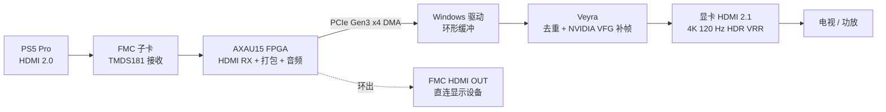

# XCAP · 为补帧而生的最强 4K HDR 采集卡

### 纯 FPGA 打造，4K60 HDR 10-bit 微秒级直达内存，让 PS5 的 30 帧变成 4K 120 Hz

**最后一个像素到达 → 约 10 µs 进内存 · 4:2:2 10-bit 无压缩 · 逐片 CRC 校验 0 错误 · 杜比全景声位流直通 · 源码公开**

*A source-available FPGA HDMI capture card (Artix UltraScale+, PCIe Gen3 x4 DMA) that lands every 4K60 HDR frame in PC memory ~10 µs after its last pixel — uncompressed 4:2:2 10-bit, CRC-checked, with Dolby Atmos bitstream passthrough — built to frame-generate console games to 4K 120 Hz with as little added latency as possible.*

## 市售采集卡做不到的事

主机游戏常锁 30 fps。想在 PC 上用 AI 补到 120 fps，采集这一步必须几乎不花时间、也不能丢画质。市售采集卡是为录像和直播设计的，XCAP 是为补帧设计的：

- ⚡ **约 10 µs 进内存，不等整帧。** FPGA 直接接收 HDMI，PCIe DMA 写进内核环形缓冲，并按片（若干行）报告进度，补帧软件边收边传显卡。市售卡走 DirectShow / Media Foundation 按整帧交付，没有一家公布过采集延迟。
- 🎨 **4K60 HDR 以 4:2:2 10-bit 无压缩进内存。** 市售卡的 10-bit 只有 P010（4:2:0，色度只剩四分之一），Elgato 4K X 的 4K HDR 采集只到 30 fps，高帧率模式还要靠 MJPG 压缩。XCAP 每帧都是 v210，色度分辨率是 P010 的两倍，没有任何压缩。
- ✅ **每一帧都可验证。** 帧头帧尾带序号、时间戳、逐片 CRC-32C 和重复帧标志：丢没丢帧、坏没坏数据、是不是重复帧，软件一看就知道。长时间运行 0 丢帧、0 CRC 错误。
- 🔊 **杜比全景声原样进电脑、原样出功放。** TrueHD/MAT、E-AC-3 JOC 位流与 7.1 PCM 都能采集并直通，延迟自动跟随画面。竞品官网最多写到 LPCM。
- 🧠 **按你的电视合成 EDID。** PS5 看到的 HDR 亮度、声道、杜比格式和直连电视时一致，而不是采集卡的固定 EDID。
- 🔓 **从 RTL 到驱动源码全部公开。** FPGA、固件、Windows 驱动、主机库、补帧集成都在这里，没有黑盒；个人自用免费。

## 和市售采集卡比

| | **XCAP** | 圆刚 Live Gamer 4K **GC573** | Elgato **4K60 Pro MK.2** | Elgato **4K Pro** | Elgato **4K X** |
|---|---|---|---|---|---|
| 采集到内存延迟 | ✅ **约 10 µs**（最后一个像素 → 内存，按片可读） | 厂商未公布 | 厂商未公布 | 厂商未公布，宣传「超低延迟」 | 厂商未公布，宣传「超低延迟」 |
| 4K60 HDR 进内存格式 | ✅ **v210：4:2:2 10-bit，无压缩** | P010：4:2:0 10-bit | 厂商未列 | 厂商未列 | 4K HDR 仅 4K30（P010，4:2:0） |
| 帧完整性 | ✅ 每帧序号、时间戳、逐片 CRC-32C、重复帧标志 | — | — | — | — |
| 音频 | ✅ 7.1 PCM + **Dolby Atmos 位流**（TrueHD/MAT、E-AC-3 JOC）采集并直通 | 7.1 / 5.1 LPCM 环出 | 厂商未列 | 厂商未列 | 厂商未列 |
| EDID | ✅ 按你的电视和功放合成 | 固定 | 固定 | 固定 | 固定 |
| 接口 | PCIe **Gen3 x4**（XDMA） | PCIe Gen2 x4 | PCIe Gen2 x4 | PCIe Gen2 x4 | USB 3.2 Gen2（10 Gbps） |
| 环出延迟 | 不经过电脑，FIFO 中几十到几百个像素 | 厂商未公布 | 厂商宣传「无延迟环出」 | 厂商宣传「超低延迟环出」 | 厂商宣传「超低延迟环出」 |
| HDMI 输入 / 环出 | 2.0 / 2.0 | 2.0 / 2.0 | 2.0 / 2.0 | 2.1 / 2.1 | 2.1 / 2.1 |
| 最高采集 | 4K60 HDR10（目前只做 3840×2160） | 4K60 HDR、1440p144、1080p240 | 4K60 HDR10 | 4K60 HDR、1440p144 HDR、1080p240 | 4K144 SDR；HDR 最高 4K30 |
| 最高环出 | 4K60 HDR10 | 4K60 HDR、1440p144、1080p240 | 4K60 HDR10 | 8K60、4K240，含 VRR / ALLM | 4K144、1440p240，含 VRR |
| 源码 | ✅ RTL、固件、驱动、主机库全部公开 | 不公开 | 不公开 | 不公开 | 不公开 |
| 驱动 / 系统 | Windows 11，测试签名 KMDF | Windows 10+ | Windows 10+ | Windows | Windows / macOS（Mac 上 HDR 转 SDR） |
| HDCP | 不支持（PS5 需关闭） | 不支持 | 不支持 | 不支持 | 不支持 |
| 价格 | 硬件约 ¥6,000–8,000，另需 AMD HDMI IP 授权 | 官网未标价 | 官网未标价 | €299.99（Elgato 葡萄牙官网） | US$249.99（Elgato 美国官网） |

竞品数据来自厂商官网（2026 年 11 月查阅）：[GC573](https://www.avermedia.com/product-detail/GC573)、[4K60 Pro MK.2](https://help.elgato.com/hc/en-us/articles/360033795031)、[4K Pro](https://help.elgato.com/hc/en-us/articles/23710571317517)、[4K X 规格](https://help.elgato.com/hc/en-us/articles/23658118721421)与[分辨率表](https://help.elgato.com/hc/en-us/articles/23479175821069)。「厂商未公布 / 未列」指官网没有写。

**为什么 4K60 就够了：** PS5 在 HDMI 2.0 下输出的就是 4K60，补帧把它变成 4K 120 Hz 的是 PC 显卡。Elgato 4K Pro / 4K X 多出来的 HDMI 2.1 带宽用于环出高刷，对把主机画面送进补帧没有帮助；真正决定体验的是采集延迟和进内存的画质，这两项 XCAP 都领先。

## 整体结构

| 层 | 做什么 | 代码 |
|---|---|---|
| FPGA | AMD HDMI 1.4/2.0 RX 子系统接收 4K60 HDR；把每帧打包成「4 KB 帧头 + v210 像素 + 4 KB 帧尾（时间戳、逐片 CRC-32C、重复帧标志）」，长度恒定；HDMI 音频（PCM / HBR 位流）走第二个 DMA 通道；环出（HDMI TX）把画面和声音原样转发 | [`fpga/rtl`](fpga/rtl)、[`fpga/hdmi`](fpga/hdmi) |
| 固件 | MicroBlaze：EDID（内置 PCM/全景声两份，主机可写入按电视合成的 EDID）、HDR 与音频信息帧、时钟芯片与重定时器、环出 | [`fpga/hdmi/fw`](fpga/hdmi/fw) |
| 驱动 | Windows KMDF：循环描述符 + 内核环形缓冲，只读映射给应用，按片报告进度；异常退出、强杀进程、设备掉线都能安全回收 | [`driver`](driver) |
| 主机库 | 打开设备、等片、读音频包、卡时钟与系统时钟对齐、EDID 合成、无硬件的虚拟卡 | [`host`](host)、[`common`](common) |
| 补帧软件 | Veyra（GPL-3.0）里的 XCAP 采集源：按片上传显卡、HDR10 元数据、7.1 PCM 与杜比位流独占直通 | [Veyra fork 的 `xcap` 分支](https://github.com/isaac-cheng-if/Veyra-NRVideo/tree/xcap)，已向原项目提交 [PR #296](https://github.com/Likely7/Veyra-NRVideo/pull/296) |

## 实测（RTX 5090、LG G5、PS5 Pro、Yamaha RX-A4A）

| 项目 | 结果 | 来源 |
|---|---|---|
| 采集 | 4K60 HDR10，YCbCr 4:2:2 12-bit 输入（以 v210 10-bit 进内存）；最后一个像素到内存平均约 10 µs；长时间 0 丢帧、0 CRC 错误 | 实机 |
| 30 fps 游戏 | 4 倍补到 120 fps，最后一行→上屏 P95 约 33 ms，比 PS5 直连多约 30 ms（其中约 25 ms 是插帧必须等下一帧的固有时间） | 虚拟采集卡回放实测；与直连的差值为分段估算 |
| 60 fps 内容 | 2 倍补到 120 fps，比 PS5 直连多约 12 ms（只需等 8.3 ms） | 分段估算，见 [延迟拆解](docs/TUTORIAL.md#延迟) |
| 声音 | 7.1 PCM；Dolby Atmos（MAT/TrueHD、E-AC-3 JOC）独占直通，功放显示 Dolby Atmos，延迟跟随画面 | 实机 |
| 环出 | 画面、HDR 信息帧、声音原样转发；接收端不支持的杜比格式自动静音 | 实机 |

数字来自作者这一套设备，不同电视、显卡、游戏会不同。

## 开始

- **要买什么：** [docs/BOM.md](docs/BOM.md)
- **从零到能玩的教程：** [docs/TUTORIAL.md](docs/TUTORIAL.md)
- **寄存器、数据格式、测试命令：** [docs/DEVELOPMENT.md](docs/DEVELOPMENT.md)

## 重要限制

- **HDMI IP 需要授权。** FPGA 里的 AMD HDMI 1.4/2.0 RX/TX Subsystem 是付费 IP；评估授权能编译，但硬件会定时停止。仓库**不含位流**，需要用你自己的授权生成。
- **PS5 必须关闭 HDCP。** 游戏可以采集；需要 HDCP 的流媒体应用不行。
- **驱动是测试签名。** 需要关闭 Secure Boot 并开启 Windows 测试签名模式，会影响部分带反作弊的 PC 游戏。
- **补帧需要 NVIDIA RTX 40/50 系列**（Veyra 的 VFG 依赖光流硬件）。
- 插帧必须等下一帧到达，30 fps 内容固有约 25 ms 的延迟，这是方法本身决定的。

## 目录

| 目录 | 内容 |
|---|---|
| `fpga/rtl`、`fpga/tb` | 采集核心 RTL 与仿真 |
| `fpga/hdmi` | 块设计 `bd.tcl`、两种 FMC 卡的引脚约束、EDID 生成器、MicroBlaze 固件 `fw/` |
| `fpga/build` | Vivado 脚本：建工程、编译位流、JTAG 下载、QSPI 烧录 |
| `constraints` | 早期约束草稿 |
| `driver` | Windows KMDF 驱动（PCI 10EE:A15C） |
| `host`、`common` | 接收库、`xcap_test`、`xcap_play`、寄存器与 IOCTL 定义 |
| `tools` | 部署、加载位流、截图转换、TMDS 分析等脚本 |
| `selftest` | 板卡自检工程（DDR、IO、GTH） |
| `veyra` | Veyra 编译脚本 |
| `docs` | 文档 |

## 许可

**个人自用、学习、研究免费，禁止商业使用。** 主体采用 [PolyForm Noncommercial 1.0.0](LICENSE.md)；被 Veyra 编译进去的主机接收库保持 GPL-3.0，第三方固件文件保持 MIT。各部分的划分、什么算商业使用、如何取得商业授权，见 [LICENSING.md](LICENSING.md)。

不含任何位流、授权 IP、厂商 BSP、签名证书或个人设备数据。
