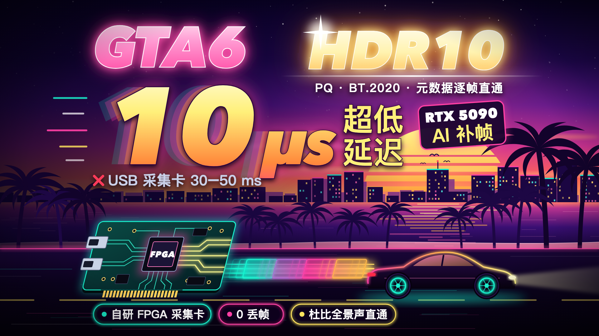
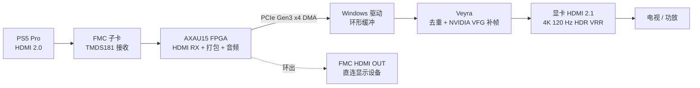

# XCAP：自研 PCIe HDMI 采集卡，把主机画面送进 PC 补帧

**PS5 / PS5 Pro → FPGA 采集卡（PCIe，约 10 µs 到内存）→ RTX 显卡 AI 补帧 → 4K 120 Hz HDR10 + 杜比全景声直通**

*An open FPGA HDMI 2.0 capture card (Artix UltraScale+, PCIe XDMA) with a Windows driver and a Veyra integration, built to frame-generate console games with as little added latency as possible.*

## 为什么要自己做采集卡

主机游戏常锁 30 fps。想在 PC 上用 AI 补到 120 fps，采集这一步必须几乎不花时间：普通 USB 采集卡要 30–50 ms 才把画面交给电脑，加上插帧本身固有的等待，延迟就没法玩了。XCAP 用 FPGA 直接接收 HDMI，再通过 PCIe DMA 写进内存，一帧最后一个像素到达后约 10 µs 就能被补帧软件读到。

## 整体结构

| 层 | 做什么 | 代码 |
|---|---|---|
| FPGA | AMD HDMI 1.4/2.0 RX 子系统接收 4K60 HDR；把每帧打包成「4 KB 帧头 + v210 像素 + 4 KB 帧尾（时间戳、逐片 CRC-32C、重复帧标志）」，长度恒定；HDMI 音频（PCM / HBR 位流）走第二个 DMA 通道；环出（HDMI TX）把画面和声音原样转发 | [`fpga/rtl`](fpga/rtl)、[`fpga/hdmi`](fpga/hdmi) |
| 固件 | MicroBlaze：EDID（内置 PCM/全景声两份，主机可写入按电视合成的 EDID）、HDR 与音频信息帧、时钟芯片与重定时器、环出 | [`fpga/hdmi/fw`](fpga/hdmi/fw) |
| 驱动 | Windows KMDF：循环描述符 + 内核环形缓冲，只读映射给应用，按片报告进度；异常退出、强杀进程、设备掉线都能安全回收 | [`driver`](driver) |
| 主机库 | 打开设备、等片、读音频包、卡时钟与系统时钟对齐、EDID 合成、无硬件的虚拟卡 | [`host`](host)、[`common`](common) |
| 补帧软件 | Veyra（GPL-3.0）里的 XCAP 采集源：按片上传显卡、HDR10 元数据、7.1 PCM 与杜比位流独占直通 | [Veyra fork 的 `xcap` 分支](https://github.com/isaac-cheng-if/Veyra-NRVideo/tree/xcap)，已向原项目提交 [PR #296](https://github.com/Likely7/Veyra-NRVideo/pull/296) |

## 实测（RTX 5090、LG G5、PS5 Pro、Yamaha RX-A4A）

| 项目 | 结果 |
|---|---|
| 采集 | 4K60 HDR10，YCbCr 4:2:2 12-bit；最后一个像素到内存平均约 10 µs；长时间 0 丢帧、0 CRC 错误 |
| 60 fps 内容 | 2 倍补到 120 fps，采集→提交显示 P95 约 16 ms，比 PS5 直连多约 12 ms |
| 30 fps 游戏 | 4 倍补到 120 fps，采集→提交显示 P95 约 33 ms，比 PS5 直连多约 30 ms（其中约 25 ms 是插帧必须等下一帧的固有时间） |
| 声音 | 7.1 PCM；Dolby Atmos（MAT/TrueHD、E-AC-3 JOC）独占直通，功放显示 Dolby Atmos，延迟跟随画面 |
| 环出 | 画面、HDR 信息帧、声音原样转发；接收端不支持的杜比格式自动静音 |

数字来自作者这一套设备，不同电视、显卡、游戏会不同。

## 开始

- **要买什么：** [docs/BOM.md](docs/BOM.md)
- **从零到能玩的教程：** [docs/TUTORIAL.md](docs/TUTORIAL.md)
- **寄存器、数据格式、测试命令：** [docs/DEVELOPMENT.md](docs/DEVELOPMENT.md)

## 重要限制

- **HDMI IP 需要授权。** FPGA 里的 AMD HDMI 1.4/2.0 RX/TX Subsystem 是付费 IP；评估授权能编译，但硬件会定时停止。仓库**不含位流**，需要用你自己的授权生成。
- **PS5 必须关闭 HDCP。** 游戏可以采集；需要 HDCP 的流媒体应用不行。
- **驱动是测试签名。** 需要关闭 Secure Boot 并开启 Windows 测试签名模式，会影响部分带反作弊的 PC 游戏。
- **补帧需要 NVIDIA RTX 40/50 系列**（Veyra 的 VFG 依赖光流硬件）。
- 插帧必须等下一帧到达，30 fps 内容固有约 25 ms 的延迟，这是方法本身决定的。

## 目录

| 目录 | 内容 |
|---|---|
| `fpga/rtl`、`fpga/tb` | 采集核心 RTL 与仿真 |
| `fpga/hdmi` | 块设计 `bd.tcl`、两种 FMC 卡的引脚约束、EDID 生成器、MicroBlaze 固件 `fw/` |
| `fpga/build` | Vivado 脚本：建工程、编译位流、JTAG 下载、QSPI 烧录 |
| `constraints` | 早期约束草稿 |
| `driver` | Windows KMDF 驱动（PCI 10EE:A15C） |
| `host`、`common` | 接收库、`xcap_test`、`xcap_play`、寄存器与 IOCTL 定义 |
| `tools` | 部署、加载位流、截图转换、TMDS 分析等脚本 |
| `selftest` | 板卡自检工程（DDR、IO、GTH） |
| `veyra` | Veyra 编译脚本 |
| `docs` | 文档 |

## 许可

GPL-3.0（见 [LICENSE](LICENSE)），与 Veyra 一致。第三方文件的来源见 [`fpga/hdmi/fw/THIRD_PARTY.md`](fpga/hdmi/fw/THIRD_PARTY.md)。不含任何位流、授权 IP、厂商 BSP、签名证书或个人设备数据。
